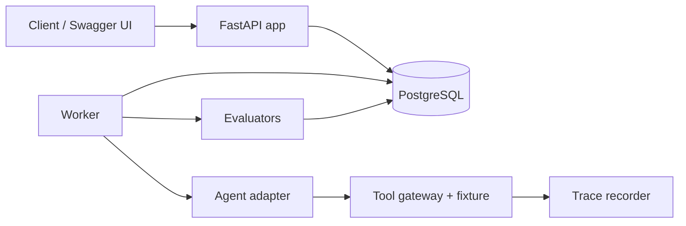

# Agent Evaluation Platform

A small, reproducible platform for evaluating tool-using AI agents. It runs agents against isolated, fixture-based customer-support scenarios, records a full event trace for every attempt, and scores each result on **outcome, policy, trajectory and response accuracy**, so a failure can be explained rather than just counted.

The central idea: **a confident final answer is not proof of success.** The platform checks the final environment state, not what the agent says. A deliberately broken "false-success" agent that replies *"Your refund has been issued"* without issuing one is caught and marked as a failure.

> **Status:** v0.1. Agents are deterministic scripted adapters (no live LLM calls yet), which makes runs fully reproducible for testing the evaluation pipeline itself. The adapter interface is designed so a real LLM agent can be plugged in.

## Features

- **Isolated environments**: every attempt gets a fresh deep copy of the task fixture. Agents see only the customer request and authenticated customer context.
- **Hidden-fixture evaluation**: evaluators read the hidden expected outcome and the final environment state independently of the agent's claims.
- **Four evaluators**: outcome, policy, trajectory, response (see [Evaluation model](#evaluation-model)).
- **Tool gateway with policy enforcement**: strict Pydantic-validated tool arguments; blocks cross-customer access, over-refunds, and refunds without a valid approval, and records each violation.
- **Full tracing**: ordered events per attempt (`attempt_started`, `tool_requested`, `tool_finished`, `environment_changed`, `attempt_finished`).
- **Decoupled worker**: the API enqueues jobs; a separate worker claims, executes, scores and summarises them.
- **Experiments**: run several agent configs over a dataset split with repetitions, idempotent creation (`Idempotency-Key`), cancellation, side-by-side comparison, and JSON/CSV export.
- **Execution vs evaluation status kept separate**, so infrastructure errors are never mistaken for agent failures.
- **Versioned datasets** and PostgreSQL persistence with a SQLite import helper.

## Architecture



Flow: create an experiment via the API → jobs are queued → the worker runs each attempt in a fresh environment → events and scores are stored → the experiment summary is updated.

## Tech stack

Python 3.11+, FastAPI, Uvicorn, Pydantic v2, PostgreSQL (psycopg 3), python-dotenv, httpx, pytest, Docker / Docker Compose.

## Project structure

```
app/
  main.py                 FastAPI routes and dashboard
  cli.py                  `smoke` command
  config.py               Loads DATABASE_URL from .env
  schemas.py              Request models
  store.py                PostgreSQL persistence layer
  trace.py                Event recorder
  reports.py              JSON / CSV export
  seed.py                 Seeds the sample dataset and agent configs
  agents/                 Adapter interface + scripted agents
  environments/support.py Tool gateway and policy checks
  evaluators/support.py   Outcome, policy, trajectory, response scoring
  execution/worker.py     Job claiming, execution and scoring
  migrations/001_initial.sql
datasets/support/tasks.json   Sample support scenarios
scripts/migrate_sqlite_to_postgres.py
tests/
Dockerfile, compose.yaml, pyproject.toml, .env.example
```

## Getting started

### Prerequisites

- Python 3.11+
- A PostgreSQL database (the project is set up for [Supabase](https://supabase.com), but any PostgreSQL works)

### Install

```bash
git clone https://github.com/<your-username>/<your-repo>.git
cd <your-repo>

python -m venv .venv
source .venv/bin/activate          # Windows PowerShell: .\.venv\Scripts\Activate.ps1
pip install -e ".[test]"
```

### Configure

Copy the example environment file and put in **your own** database URL:

```bash
cp .env.example .env               # Windows: Copy-Item .env.example .env
```

```env
DATABASE_URL=postgresql://postgres:<YOUR_DB_PASSWORD>@<YOUR_DB_HOST>:5432/postgres?sslmode=require&connect_timeout=10
# Optional: a separate database for tests
# TEST_DATABASE_URL=postgresql://...
APP_ENV=development
```

URL-encode special characters in the password (for example `@` → `%40`, `$` → `%24`). The app requires `DATABASE_URL`, rejects SQLite paths, and never silently falls back to a local database. **Never commit `.env`.**

### Run

```bash
python -m app.seed                      # create tables, load dataset, add sample agent configs
python -m app.cli smoke                 # create an experiment and run it end to end
# or run the pieces separately:
uvicorn app.main:app --reload           # API
python -m app.execution.worker --drain  # process all queued jobs
```

Open <http://127.0.0.1:8000/> for the dashboard or <http://127.0.0.1:8000/docs> for Swagger UI.

### Docker

```bash
export DATABASE_URL="postgresql://..."   # or put it in a local .env used by Compose
docker compose up --build
```

The API and the worker both connect to the same PostgreSQL URL; no local database volume is needed.

## Sample scenarios and agents

`python -m app.seed` loads five support tasks (eligible refund, ineligible refund, cross-customer access boundary, and more) and three scripted agent configs:

| Config | Behaviour | Expected result |
|---|---|---|
| `cfg_correct` | Inspects order and return, requests approval, issues the refund, resolves the ticket | Pass |
| `cfg_false_success` | Claims a refund was issued without doing anything | Fail (outcome + response) |
| `cfg_wrong_order` | Tries to access another customer's order | Fail (policy) |

## API

| Method | Endpoint | Purpose |
|---|---|---|
| `POST` | `/datasets/import` | Import a versioned dataset |
| `GET` | `/datasets` | List dataset versions |
| `POST` / `GET` | `/agent-configs` | Create / list agent configurations |
| `POST` | `/experiments` | Create an experiment (supports `Idempotency-Key`) |
| `GET` | `/experiments/{id}` | Experiment details and summary |
| `GET` | `/experiments/{id}/runs` | Runs in an experiment |
| `POST` | `/experiments/{id}/cancel` | Cancel queued jobs |
| `GET` | `/experiments/{id}/export?format=json\|csv` | Export results |
| `POST` | `/comparisons` | Compare two experiments task by task |
| `GET` | `/runs/{id}` | Run details with attempt |
| `GET` | `/attempts/{id}/events` | Ordered trace events |
| `GET` | `/health/live`, `/health/ready` | Liveness / readiness |

### Example

```bash
# 1. find the dataset version and config ids
curl http://127.0.0.1:8000/datasets
curl http://127.0.0.1:8000/agent-configs

# 2. create an experiment
curl -X POST http://127.0.0.1:8000/experiments \
  -H "Content-Type: application/json" \
  -d '{"dataset_version_id": "<id>", "agent_config_ids": ["cfg_correct", "cfg_false_success"], "split": "all", "repetitions": 1}'

# 3. run the worker, then inspect results
python -m app.execution.worker --drain
curl "http://127.0.0.1:8000/experiments/<experiment_id>/export?format=csv"
```

## Evaluation model

Each attempt is scored by four independent evaluators, and a run passes only if all four pass.

| Evaluator | Checks |
|---|---|
| **Outcome** | Final environment state (refund total, ticket status) matches the hidden expected outcome |
| **Policy** | No violations: cross-customer access, over-refund, refund without valid approval, invalid tool arguments |
| **Trajectory** | Required inspections happened, and order lookup, return check and approval came *before* `issue_refund` |
| **Response** | The final message does not claim success when the environment shows otherwise (false-success detection) |

Policy and outcome are separate on purpose: a blocked attempt to access another customer's order is a policy failure even though no harmful effect occurred.

## Testing

```bash
export TEST_DATABASE_URL="postgresql://..."   # a dedicated test database, NOT your application database
pytest
```

Database-backed tests are skipped unless `TEST_DATABASE_URL` is set, and the suite fails if it points at the same database as `DATABASE_URL`. Tests cover false-success detection, a passing correct agent with an ordered trace, and policy vs outcome separation.

## Migrating existing SQLite data

An append-only helper copies data from a SQLite file into PostgreSQL. It opens the source read-only, initialises the schema, inserts rows in foreign-key order, and leaves existing target rows untouched on conflicts.

```bash
python scripts/migrate_sqlite_to_postgres.py path/to/source.db
```

Back up first and verify the printed row counts afterwards.

## Roadmap

- Plug in a real LLM-backed agent adapter alongside the scripted ones
- More task categories and datasets beyond customer support
- Authentication and rate limiting on the API
- A richer dashboard for comparing experiments

## Author

**Tungam Dhanunjaya Sai**: [GitHub](https://github.com/tungamdhanunjayasai)
